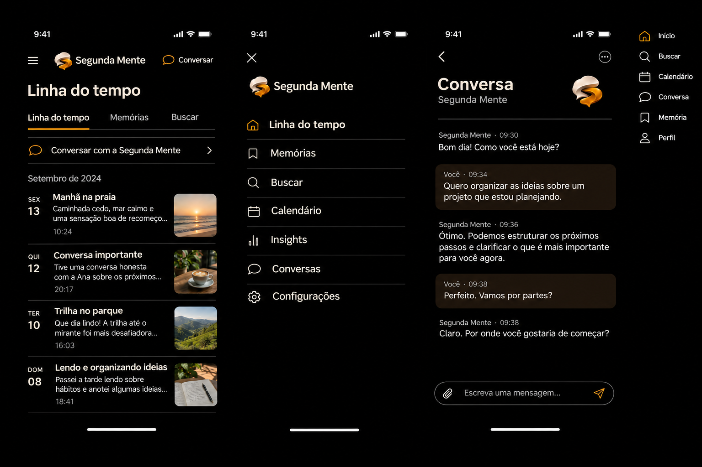

# Índice de documentação — Segunda Mente

## Retomada e escopo

- [Estado atual e próxima ação](../STATE.md)
- [Roadmap, fases e evidências](../ROADMAP.md)
- [Visão e escopo do produto](../PROJECT.md)
- [Decisões aceitas e pendentes](DECISIONS.md)
- [Regras de execução](WATCHDOG.md) · [auditoria](AUDIT.md)
- [Roteiro de teste no S25 de 2026-11-04](TESTE-NO-S25-2026-11-04.md)

## Design móvel

- [Direção visual aprovada](../DESIGN.md)
- [README e cobertura das referências v3](../.impeccable-mobile/references/amoled-v3-ios/README.md)
- [Relatório de QA das referências](../.impeccable-mobile/QA-REPORT.md)

### Pranchas aprovadas

| Referência | Arquivo |
|---|---|
| Linha do tempo e conhecimento | [imagem](../.impeccable-mobile/references/amoled-v3-ios/01-timeline-knowledge.png) |
| Insights e memórias | [imagem](../.impeccable-mobile/references/amoled-v3-ios/02-insights-memory.png) |
| Conversa e revisão de envio | [imagem](../.impeccable-mobile/references/amoled-v3-ios/03-chat-review.png) |
| Relatório e encaminhamentos | [imagem](../.impeccable-mobile/references/amoled-v3-ios/04-report-followups.png) |
| Configurações e modelos | [imagem](../.impeccable-mobile/references/amoled-v3-ios/05-settings-models.png) |
| Configuração inicial e permissões | [imagem](../.impeccable-mobile/references/amoled-v3-ios/06-setup-permissions.png) |
| Calendário e detalhe | [imagem](../.impeccable-mobile/references/amoled-v3-ios/07-calendar-detail.png) |
| Agentes e backup | [imagem](../.impeccable-mobile/references/amoled-v3-ios/08-agents-backup.png) |
| Menu, acesso ao chat e ícones | [imagem](../.impeccable-mobile/references/amoled-v3-ios/09-navigation-chat-icons.png) |
| Estados vazios e erro | [imagem](../.impeccable-mobile/references/amoled-v3-ios/10-primary-states.png) |
| Captura rápida, anexos e gravação | [imagem](../.impeccable-mobile/references/amoled-v3-ios/11-capture-quick-record.png) |
| Tipos de registro da timeline (1) | [imagem](../.impeccable-mobile/references/amoled-v3-ios/12-timeline-card-types.png) |
| Tipos de registro (2) e detalhe de métrica | [imagem](../.impeccable-mobile/references/amoled-v3-ios/13-timeline-card-types-2.png) |
| Companheiro, perfil e central de ações | [imagem](../.impeccable-mobile/references/amoled-v3-ios/14-companion-profile-states.png) |
| Bloqueio biométrico e por PIN | [imagem](../.impeccable-mobile/references/amoled-v3-ios/15-app-lock.png) |
| Busca global e resultados | [imagem](../.impeccable-mobile/references/amoled-v3-ios/16-global-search.png) |
| Variações de insight | [imagem](../.impeccable-mobile/references/amoled-v3-ios/17-insight-variants.png) |
| Atividade dos agentes | [imagem](../.impeccable-mobile/references/amoled-v3-ios/18-agent-activity.png) |
| Pôster e compartilhamento | [imagem](../.impeccable-mobile/references/amoled-v3-ios/19-share-poster.png) |
| Tour de boas-vindas e guia | [imagem](../.impeccable-mobile/references/amoled-v3-ios/20-welcome-tour.png) |
| Leitor de arquivo de Conhecimento | [imagem](../.impeccable-mobile/references/amoled-v3-ios/21-knowledge-reader.png) |
| Importação DOCX/TXT | [imagem](../.impeccable-mobile/references/amoled-v3-ios/22-import-data.png) |
| Contexto de localização (OpenStreetMap) | [imagem](../.impeccable-mobile/references/amoled-v3-ios/23-location-context.png) |

### Implementação das pranchas 17, 19, 20 e 22

| Prancha | Subfase | Componentes existentes | Limite aplicado |
|---|---|---|---|
| 17 — Variações de insight | F5V-02 | `insight_screen.dart`, `insight_detail_page.dart`, `NativeWidgetFactory` e `insight_cards/` | Gráficos, mapas geográficos com coordenadas, timeline e narrativa. Não há grafo de conexões disponível. |
| 20 — Tour e GUIAS | F5V-02 | `demo_overlay.dart`, `KnowledgeBaseViewModel` e `KnowledgeBaseScreen` | Tour em três passos; o guia existente é apenas listado e renomeado na interface, sem alterar `Memex Guide.md`. |
| 22 — Importação | F5V-03 | `TranscriptFileImportButton`, `TranscriptImportService` e rota de atividade existente | Lista, prévia, confirmação, progresso e falha para TXT. DOCX adiado porque a F2-03 só autoriza TXT. |
| 19 — Compartilhamento | F5V-04 | `SharePreviewDialog`, `SharePosterDecorator` e `ShareService` | Prévia e folha nativa; sem data, edição de texto ou compartilhamento por proximidade. |

### Referência principal de navegação

## Evidência do MVP

- [Checklist dos sete critérios F5-01](F5-01-checklist.md)
- [Privacidade F5-02](F5-02-privacidade.md)
- [Viabilidade F8-01 (NotebookLM)](F8-01-viabilidade.md)
- [Mapeamento F9-01](F9-01-mapeamento.md)
- [Corpus F9-02](F9-02-corpus.md)
- [Plano de medição F7-02](F7-02-plano-de-medicao.md)
- [Plano de medição F2-11](F2-11-plano-de-medicao.md)
- [Medições F5-03](F5-03-medicoes.md)
- [Revisão F5](reviews/F5.md)
- [Captura do S25 Ultra](s25_screenshot.png)
